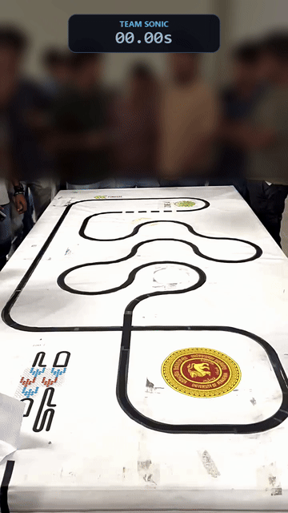
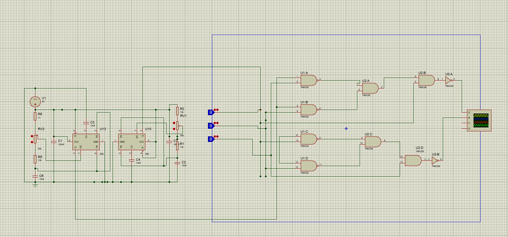
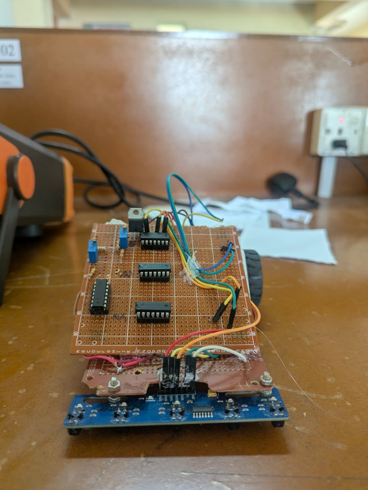
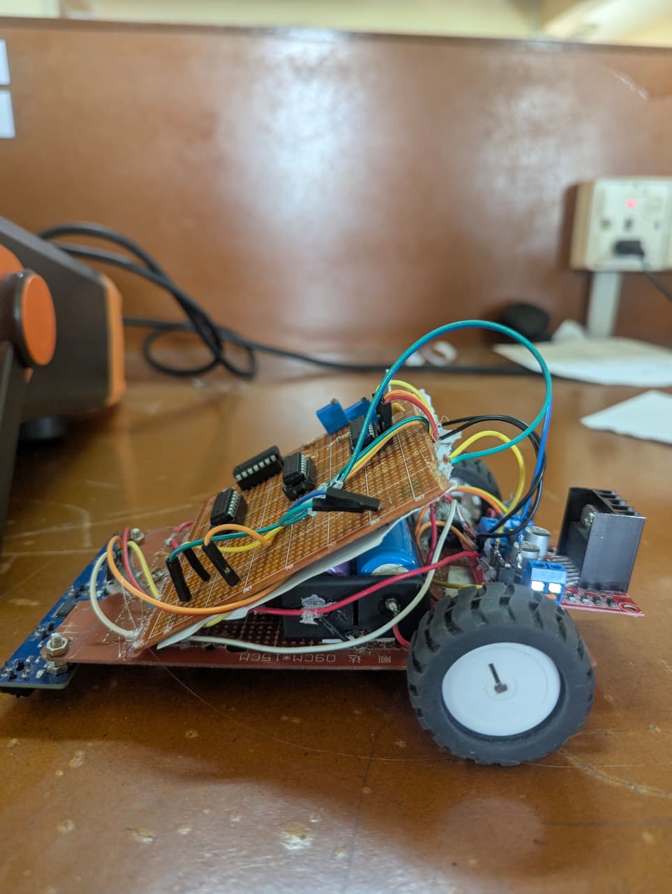
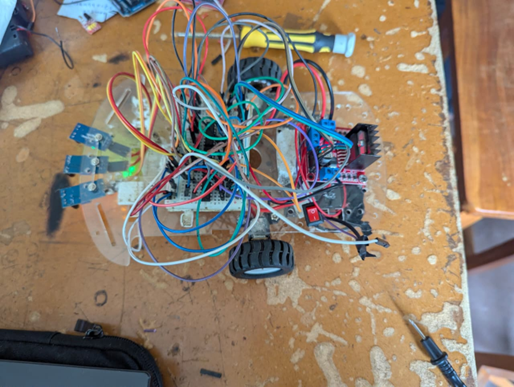
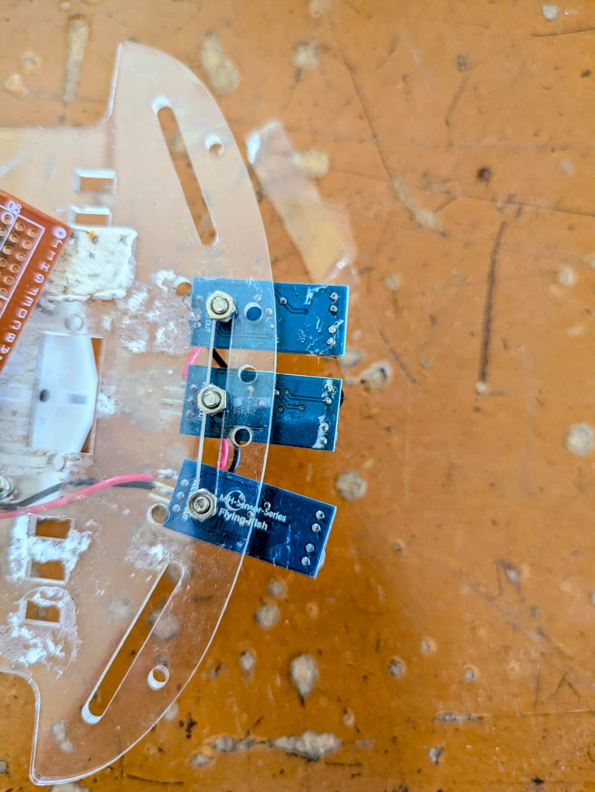

# Sonic: Autonomous Line Following Robot (Discrete Logic)

> **EE2030: Digital Logic Design and Synthesis**  
> Department of Electrical & Electronic Engineering, Faculty of Engineering  
> **University of Peradeniya**


-red.svg)


---

## Overview

**Sonic** is an autonomous line-following robot designed, iterated, and fabricated entirely using discrete logic integrated circuits and analog timing circuits. **No microcontrollers, microprocessors, or programmable logic devices (FPGAs/CPLDs) were used.**

All track sensing, logic synthesis, motor steering decisions, and pulse-width modulation (PWM) are evaluated continuously in hardware with zero firmware overhead and microsecond-level propagation delay.

<div align="center">
  
  <p><em>Official competition run: 0:19.18 lap time on live timing board</em></p>
</div>

---

## Competition Performance

During the final module evaluation heats at the Department of Electrical & Electronic Engineering, Team Sonic clocked an official **0:19.18** run on the live competition timing board.

<div align="center">
  
  <p><em>Team Sonic in front of the competition timing board after the 0:19.18 run</em></p>
</div>

---

## Circuit Simulation (Proteus 8)

Before physical assembly, the complete timing and logic network was modeled and verified in **Labcenter Proteus 8 Professional**. 

To resolve SPICE convergence errors (`Gmin step failed`) inherent to the shared internal ground of the NE556 SPICE model, two independent NE555 instances were configured in simulation to model the dual PWM generation driving the quad NAND (74HC00) and quad AND (74HC08) steering network.

<div align="center">
  
  <p><em>Proteus 8 simulation schematic: dual 555 PWM generation, combinational logic cascade, and oscilloscope verification</em></p>
</div>

The complete simulation project file is available in this repository:
- **[Download Proteus 8 Project (.pdsprj)](simulation/Sonic_Logic_Simulation_V3.pdsprj)**

---

## System Architecture

```text
  [ TCRT5000 IR Sensor Array ] (5-Channel Array: Middle 3 Channels Wired)
                │
                ▼
  [ Stage 0: SN74HC04N Hex Inverters ] (Active-Low to Active-High Polarity Flip)
                │
                ▼
  [ Stage 1: SN74HC00N Quad NAND Gates ] <── [ NE556N Dual Timer (Dual Independent PWM) ]
                │
                ▼
  [ Stage 2: SN74HC08N Quad AND Cascade ]
                │
                ▼
  [ Stage 3: SN74HC04N Output Inverters ]
                │
                ▼
  [ L298N Dual H-Bridge Motor Driver ]
                │
        ┌───────┴───────┐
        ▼               ▼
  [ Left N20 Motor ] [ Right N20 Motor ]
```

### Key Hardware & Routing Design Decisions

1. **3-Channel Sensor Selection from 5-Channel Array**:  
   Although a 5-channel TCRT5000 infrared reflectance array is physically mounted to the chassis, **only the middle 3 channels (Left, Center, Right) are wired into the logic**. The two outermost sensors were left unconnected. A 3-sensor differential scheme provided all necessary line-tracking resolution while keeping the Boolean expressions and required gate count minimal.

2. **Sensor Polarity Adaptation**:  
   The combinational logic network was designed for an active-high (`black = 1`) convention. When switching to the TCRT5000 array (which outputs active-low signals where white is 1 and black is 0), three unused inverter gates on the onboard **SN74HC04N** hex inverter were utilized to invert the L, C, and R signals. This avoided altering the downstream Boolean network or adding extra ICs.

3. **Dual Independent PWM Generation**:  
   An **NE556N** dual bipolar timer operates as two independent astable multivibrators. Each channel drives one side of the differential drive system. Precision $50\,\text{k}\Omega$ trimpots allow independent duty-cycle trimming to eliminate mechanical motor RPM drift and ensure stable straight-line tracking.

4. **Combinational Steering Network**:  
   Quad NAND (**SN74HC00N**) and quad AND (**SN74HC08N**) gates gate the sensor states against the PWM pulses to output proportional forward and turn commands directly to the **L298N** motor driver inputs.

---

## Hardware Evolution Gallery

Before the final competition chassis, the design progressed through breadboard prototyping and early perfboard revisions:

| Prototype Chassis (V5) - Front View | Prototype Chassis (V5) - Side Profile |
| :---: | :---: |
| <br><em>Front view of prototype chassis (V5) showing middle 3 sensor pins wired</em> | <br><em>Side profile showing stacked perfboard layout and motor driver</em> |

| Initial Breadboard Prototype | Early Flying-Fish Sensor Mount |
| :---: | :---: |
| <br><em>Early breadboard implementation with Flying-Fish sensors</em> | <br><em>Initial 3-channel reflectance mount using Flying-Fish modules</em> |

---

## Bill of Materials (BOM)

| Component | Part Number / Specification | Functional Role |
| :--- | :--- | :--- |
| **Hex Inverter** | SN74HC04N | Sensor polarity inversion & driver signal complement |
| **Quad 2-Input NAND** | SN74HC00N | Combinational logic gating with PWM pulses |
| **Quad 2-Input AND** | SN74HC08N | Motor steering logic cascade |
| **Dual Timer** | NE556N | Independent dual-channel analog PWM generator |
| **Motor Driver** | L298N Dual H-Bridge | High-current drive stage for DC gearmotors |
| **IR Sensor Array** | TCRT5000 (5-Channel) | Optical line tracking (middle 3 channels wired) |
| **Voltage Regulator** | LM2596 DC-DC Buck | Stable 5V step-down for logic and motor rails |
| **Motors** | 2x N20 Micro Metal Gearmotors | Differential drive propulsion |
| **Power Source** | 2S Li-ion (7.4V to 8.4V) | Primary battery power |

---

## Engineering Challenges & Hardware Solutions

### 1. Breadboard Noise & Fault Isolation
High jumper lead density on early breadboards introduced contact capacitance, ground bounce, and intermittent connections. The system was migrated to a structured perfboard with DIP IC sockets, isolated power rails, and labeled net traces.

### 2. Proteus SPICE Convergence
The NE556 SPICE model in Proteus 8 generated `Gmin step failed` errors when both internal timers shared ground. The simulation was resolved by modeling two separate NE555 timer circuits, which validated timing before physical assembly.

### 3. Active-Low Sensor Polarity Workaround
Switching from active-high Flying-Fish sensors to the active-low TCRT5000 array was resolved by utilizing 3 unused gates on the existing SN74HC04N hex inverter to invert the inputs, preserving the Boolean logic without adding extra silicon.

### 4. Straight-Line Motor Drift
Manufacturing variances between the N20 gearmotors caused directional drift under uniform PWM. Independent trimpots on each NE556 timer channel allowed precise duty-cycle trimming to balance motor RPM for straight runs.

---

## Documentation & Files

- [Project Journal & Design Report (PDF)](Journal.pdf)
- [Proteus 8 Simulation File (.pdsprj)](simulation/Sonic_Logic_Simulation_V3.pdsprj)

---

## Our Journey and Acknowledgments

What started as a sprawling nest of jumper wires on an acrylic breadboard chassis evolved into a tuned, high-speed discrete logic line follower. Along the way, our team navigated Proteus SPICE non-convergence errors, solved TCRT5000 active-low polarity mismatches using spare inverter gates, eliminated motor RPM drift with independent dual-channel analog PWM, and finalized the chassis for competition day.

A heartfelt thank you to all my teammates in **Team Sonic (Group 03)** for the late nights in the lab, the patience through tedious hardware fault isolation, and the shared drive that took this project from Karnaugh maps to an official 0:19.18 competition run!

---

## Team Sonic (Group 03)

- **G.A.K.S. Devindya** (E/22/073)
- **D.A.S.R. Dharmarathna** (E/22/076)
- **E.T. Dheerasinghe** (E/22/077)
- **M.M.A. Dilhara** (E/22/079)
- **B.M.A.S. Dilshan** (E/22/080)
- **D.M.A.S. Dissanayake** (E/22/085)

*Department of Electrical and Electronic Engineering, University of Peradeniya.*
