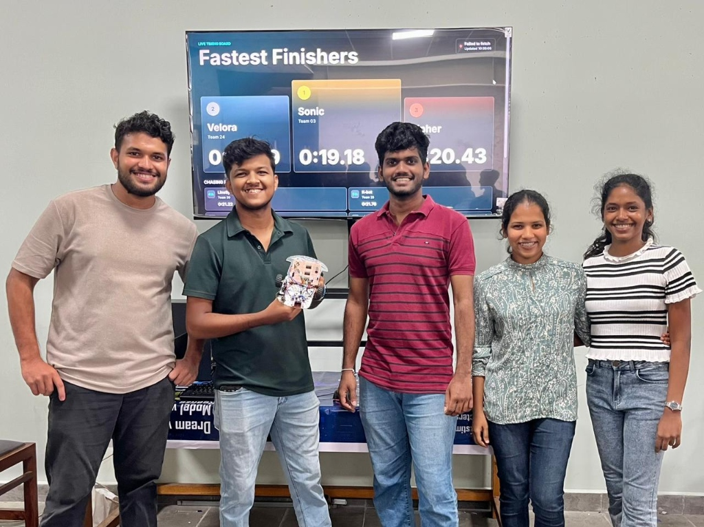

# Sonic: Autonomous Line Following Robot (Discrete Logic)

> **EE2030: Digital Logic Design and Synthesis**  
> Department of Electrical & Electronic Engineering, Faculty of Engineering  
> **University of Peradeniya**


-red.svg)
-success.svg)

---

## Overview

**Sonic** is an autonomous line-following robot designed, iterated, and fabricated entirely using discrete logic integrated circuits and analog timing circuits. **No microcontrollers, microprocessors, or programmable logic devices (FPGAs/CPLDs) are used.**

All state evaluation, sensor signal conditioning, motor steering logic, and pulse-width modulation (PWM) are computed continuously in hardware with zero software overhead and microsecond-level propagation delay.

<div align="center">
  
  <p><em>Official competition run: 0:19.18 lap time on live timing board</em></p>
</div>

---

## Competition Performance

During the final module evaluation at the Department of Electrical & Electronic Engineering, Team Sonic clocked an official **0:19.18** run on the live timing board, holding **P1 (Fastest Finishers)** during peak heats.

<div align="center">
  
  <p><em>Team Sonic holding #1 on the live timing board (0:19.18)</em></p>
</div>

---

## System Architecture

```text
  [ TCRT5000 IR Sensor Array ] (L, C, R Channels)
                │
                ▼
  [ Stage 0: SN74HC04N Hex Inverters ] (Active-Low to Active-High Polarity Flip)
                │
                ▼
  [ Stage 1: SN74HC00N Quad NAND Gates ] <── [ NE556N Dual Timer (Dual Independent PWM) ]
                │
                ▼
  [ Stage 2: SN74HC08N Quad AND Cascade ]
                │
                ▼
  [ Stage 3: SN74HC04N Output Inverters ]
                │
                ▼
  [ L298N Dual H-Bridge Motor Driver ]
                │
        ┌───────┴───────┐
        ▼               ▼
  [ Left N20 Motor ] [ Right N20 Motor ]
```

### Signal Flow & Logic States
1. **Sensing**: A 5-channel TCRT5000 infrared reflectance array monitors the track. The 3 center channels (Left, Center, Right) feed the digital logic.
2. **Polarity Adaptation**: Because the sensor outputs active-low signals (black = 0, white = 1), spare gates in an **SN74HC04N** hex inverter complement the signals so that the internal logic operates under the standard active-high (`black = 1`) convention without requiring extra ICs.
3. **PWM Generation**: An **NE556N** dual bipolar timer generates independent high-frequency PWM pulses for both left and right drive channels. Individual $50\,\text{k}\Omega$ trimpots allow fine duty-cycle trimming to eliminate mechanical motor RPM drift.
4. **Logic Synthesis**: Quad NAND (**SN74HC00N**) and quad AND (**SN74HC08N**) gates gate the sensor states against the PWM pulses to output proportional steering commands.
5. **Actuation**: An **L298N** dual H-bridge drives two high-torque N20 micro metal gearmotors.

---

## Bill of Materials (BOM)

| Component | Part Number / Spec | Purpose |
| :--- | :--- | :--- |
| **Hex Inverter** | SN74HC04N | Polarity conditioning & driver complement |
| **Quad 2-Input NAND** | SN74HC00N | Combinational logic gating with PWM |
| **Quad 2-Input AND** | SN74HC08N | Motor steering logic cascade |
| **Dual Timer** | NE556N | Dual independent PWM generator |
| **Motor Driver** | L298N H-Bridge | High-current motor drive stage |
| **Sensor Array** | TCRT5000 (5-Ch) | Infrared reflectance track detection |
| **Step-Down Regulator**| LM2596 DC-DC Buck | Stable 5V logic & motor rail regulation |
| **Actuators** | 2x N20 Micro Gearmotors | Differential drive propulsion |
| **Power Supply** | 2S Li-ion / 7.4V–8.4V | Main power source |

---

## Engineering Challenges & Hardware Solutions

### 1. Breadboard to Perfboard Transition
High jumper lead density on initial breadboard prototypes introduced stray capacitance, ground bounce, and intermittent contact faults. The system was migrated to a dedicated perfboard with DIP sockets, distinct power planes, and dedicated signal routing paths.

### 2. Proteus SPICE Model Convergence
In Proteus 8, the default NE556 SPICE subcircuit model threw non-convergence errors (`Gmin step failed`) when both internal timers shared a common ground node. The simulation was resolved by decoupling the dual timer into two independent NE555 instances, which validated the timing before physical assembly.

### 3. Active-Low Polarity Workaround
Switching from Flying-Fish sensors (active-high) to the TCRT5000 array (active-low) threatened a complete redesign of the Boolean network. Instead of restructuring the logic gates, 3 unused inverter gates on the existing SN74HC04N were used to invert the sensor inputs, preserving the original derivation with zero added silicon.

### 4. Mechanical Motor Drift Calibration
Due to manufacturing tolerances between DC motors, identical PWM signals caused straight-line drift. Utilizing dual independent timers on the NE556N with precision potentiometers enabled independent per-channel calibration to ensure straight-line tracking.

---

## Documentation

- [Project Journal & Design Report (PDF)](Journal.pdf)

---

## Team Sonic (Group 03)

- **G.A.K.S. Devindya** (E/22/073)
- **D.A.S.R. Dharmarathna** (E/22/076)
- **E.T. Dheerasinghe** (E/22/077)
- **M.M.A. Dilhara** (E/22/079)
- **B.M.A.S. Dilshan** (E/22/080)
- **D.M.A.S. Dissanayake** (E/22/085)

*Department of Electrical and Electronic Engineering, University of Peradeniya.*
